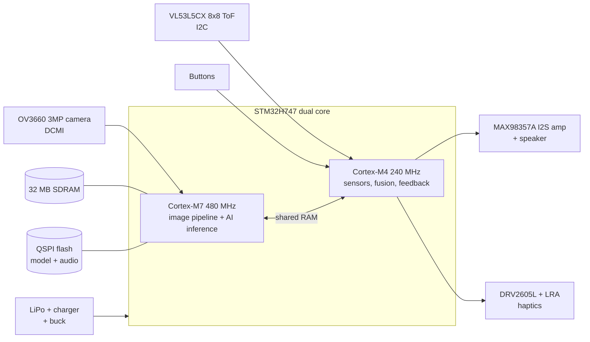

# Vision AI Assist — STM32H7

**A wearable, offline vision assistant for visually impaired people.**
It runs object detection on an STM32H7 microcontroller, measures distance with a multi-zone time-of-flight (ToF) sensor, and tells the user what is ahead through audio and vibration. No phone, no cloud, no internet.

> Status: **planning / Phase 0** — see the [project plan](docs/PLAN.md) and the [milestones](../../milestones).

---

## Why

Most assistive vision devices depend on a smartphone or a cloud connection, which adds cost, delay and privacy risk. A microcontroller-class device can be:

- **cheap** — target bill of materials under USD 60 for the wearable version
- **private** — images never leave the device
- **fast** — warn about an obstacle in under 200 ms
- **long-running** — at least 6 hours on one charge

## What it does

| Feature | How |
|---|---|
| Obstacle warning with distance | VL53L5CX 8×8 multi-zone ToF, 4 m range, ~15 Hz |
| "What is in front of me?" | 3 MP OV3660 camera → on-device object detection (people, doors, stairs, chairs, vehicles…) |
| Spoken feedback | Short pre-recorded voice prompts through an I2S amplifier and bone-conduction / mini speaker |
| Silent feedback | Vibration patterns that get faster as obstacles get closer (DRV2605L haptics) |
| Fusion | Detected objects are tagged with ToF distance: *"person, 2 metres, left"* |
| Later | Scene snapshot at full 3 MP for text reading on a paired phone (optional) |

## System at a glance



## Hardware

| Part | Choice | Role |
|---|---|---|
| MCU (prototype) | **STM32H747I-DISCO** | Dual core M7 480 MHz + M4 240 MHz, 2 MB flash, 1 MB RAM, 32 MB SDRAM, camera connector, display for debugging |
| MCU (wearable) | **STM32H747XI / STM32H743** on a custom 4-layer PCB | Same firmware, smaller board |
| Camera | **OV3660**, 3 MP (2048×1536), DVP/DCMI | Low-res frames for AI, full-res snapshots |
| Depth | **VL53L5CX**, 8×8 zones, 4 m | Obstacle distance and direction |
| Audio | **MAX98357A** I2S class-D amp + 1 W speaker or bone-conduction transducer | Voice prompts |
| Haptics | **DRV2605L** + LRA motor | Silent alerts |
| Power | 1-cell LiPo 2000 mAh, **BQ25895** charger, 3.3 V buck | 6 h+ runtime target |

Full parts list, pin plan and power budget: [docs/HARDWARE.md](docs/HARDWARE.md)

## Software

- **STM32CubeIDE + HAL**, FreeRTOS on the M4, bare-metal pipeline on the M7
- **Camera:** DCMI + DMA into SDRAM, downscale to 192×192 / 224×224 for the model
- **AI:** quantised (INT8) object detector deployed with **STM32Cube.AI (X-CUBE-AI)**, starting from the ST Model Zoo (SSD MobileNet / ST YOLO LC), fine-tuned on an assistive-navigation dataset
- **Fusion:** each detection box is mapped onto the ToF 8×8 grid to get its distance

Details: [docs/SOFTWARE.md](docs/SOFTWARE.md)

## Repository layout

```
docs/       plan, hardware design, software design, test protocol
firmware/   STM32CubeIDE projects (CM7 + CM4)
hardware/   KiCad project for the wearable board and the 3D-printed enclosure
ml/         dataset scripts, training, quantisation and Cube.AI export
tools/      PC tools: serial frame viewer, audio prompt builder
tests/      bench test scripts and results
```

## Roadmap

| Phase | Goal | Target |
|---|---|---|
| 0 | Research, requirements, parts ordered | Nov 2026 |
| 1 | Camera bring-up on STM32H747I-DISCO | Dec 2026 |
| 2 | ToF obstacle warning with haptics (first useful demo) | Jan 2027 |
| 3 | Object detection model running on the M7 | Feb 2027 |
| 4 | Fusion + voice feedback, full prototype on the Disco board | Mar 2027 |
| 5 | Custom 4-layer wearable PCB + enclosure | Apr–May 2027 |
| 6 | Field testing with visually impaired volunteers | Jun 2027 |
| 7 | Paper + thesis write-up, open-source release | Jul 2027 |

Week-by-week tasks: [docs/PLAN.md](docs/PLAN.md)

## Team

Led by **Md. Mehedi Hassan** (Dept. of EEE, Shahjalal University of Science and Technology).

## License

MIT — see [LICENSE](LICENSE).
