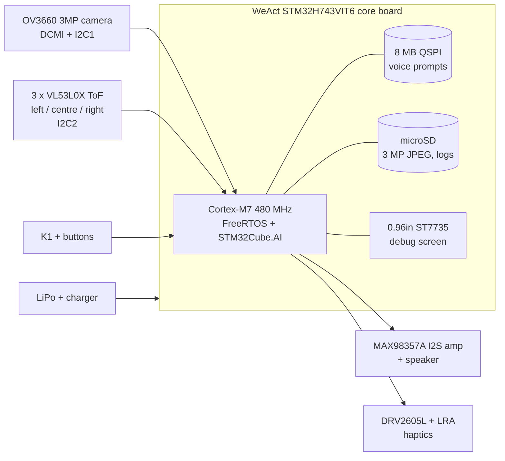

# Vision AI Assist — STM32H7

**A wearable, offline vision assistant for visually impaired people.**
It runs object detection on an STM32H7 microcontroller, measures distance with three time-of-flight (ToF) sensors (left, centre, right), and tells the user what is ahead through audio and vibration. No phone, no cloud, no internet.

> Status: **firmware v0.1 builds** (PlatformIO, STM32duino + FreeRTOS + TensorFlow Lite Micro) — see [firmware/](firmware/).
> Hardware bring-up is next. Plan: [docs/PLAN.md](docs/PLAN.md) · Milestones: [../../milestones](../../milestones)

---

## Why

Most assistive vision devices depend on a smartphone or a cloud connection, which adds cost, delay and privacy risk. A microcontroller-class device can be:

- **cheap** — target bill of materials under USD 60 for the wearable version
- **private** — images never leave the device
- **fast** — warn about an obstacle in under 200 ms
- **long-running** — at least 6 hours on one charge

## What it does

| Feature | How |
|---|---|
| Obstacle warning with distance and side | 3 × VL53L0X ToF (left / centre / right), up to 2 m, ~30 Hz |
| "What is in front of me?" | 3 MP OV3660 camera → on-device object detection (people, doors, stairs, chairs, vehicles…) |
| Spoken feedback | Short pre-recorded voice prompts through an I2S amplifier and bone-conduction / mini speaker |
| Silent feedback | Vibration patterns that get faster as obstacles get closer (DRV2605L haptics) |
| Fusion | Detected objects are tagged with the distance from the matching ToF sensor: *"person, 2 metres, left"* |
| Snapshot | Full 3 MP JPEG saved to microSD (for later text reading or dataset collection) |

## System at a glance



## Hardware

| Part | Choice | Role |
|---|---|---|
| Main board | **[WeAct STM32H743VIT6 core board](https://github.com/WeActStudio/MiniSTM32H7xx) with 0.96" TFT** | Cortex-M7 up to 480 MHz, 2 MB flash, 1 MB RAM, 8 MB QSPI + 8 MB SPI flash, DCMI camera header, microSD, USB-C |
| Camera | **OV3660**, 3 MP (2048×1536), 24-pin DVP | Small frames for AI, 3 MP JPEG snapshots to microSD |
| Depth | **3 × VL53L0X** (GY-VL53L0XV2), single-zone, up to 2 m, 25° FoV each | Obstacle distance; three sensors angled left / centre / right give direction |
| Audio | **MAX98357A** I2S amp + speaker or bone-conduction transducer | Voice prompts |
| Haptics | **DRV2605L** + LRA motor | Silent alerts |
| Power | 1-cell LiPo 2000 mAh + charger | 6 h target |

Pin map, memory plan and power budget: [docs/HARDWARE.md](docs/HARDWARE.md)

## Software

- **One Cortex-M7 running FreeRTOS.** Obstacle warnings run at the highest priority, so the neural network can never delay them.
- **Camera:** DCMI + DMA into internal SRAM (240×240 window), DMA2D resize to the model input. No SDRAM needed.
- **AI:** quantised (INT8) object detector deployed with **STM32Cube.AI**, starting from the ST Model Zoo, fine-tuned on local street and campus images.
- **Fusion:** each detection box is matched to the ToF sensor covering its part of the image (left / centre / right) to get its distance.
- **3 MP mode:** long-press K1 to save a full-resolution JPEG to the microSD card.

Details: [docs/SOFTWARE.md](docs/SOFTWARE.md)

## Repository layout

```
docs/       plan, hardware design, software design, test protocol
firmware/   STM32CubeIDE project (STM32H743, FreeRTOS)
hardware/   KiCad project for the wearable board and the 3D-printed enclosure
ml/         dataset scripts, training, quantisation and Cube.AI export
tools/      PC tools: serial frame viewer, audio prompt builder
tests/      bench test scripts and results
```

## Roadmap

| Phase | Goal | Target |
|---|---|---|
| 0 | Research, requirements, parts ordered | Nov 2026 |
| 1 | Camera bring-up on the WeAct STM32H743 board | Dec 2026 |
| 2 | ToF obstacle warning with haptics (first useful demo) | Jan 2027 |
| 3 | Object detection model running on the M7 | Feb 2027 |
| 4 | Fusion + voice feedback, full prototype on the WeAct board | Mar 2027 |
| 5 | Custom 4-layer wearable PCB + enclosure | Apr–May 2027 |
| 6 | Field testing with visually impaired volunteers | Jun 2027 |
| 7 | Paper + thesis write-up, open-source release | Jul 2027 |

Week-by-week tasks: [docs/PLAN.md](docs/PLAN.md)

## Team

Led by **Md. Mehedi Hassan** (Dept. of EEE, Shahjalal University of Science and Technology).

## License

MIT — see [LICENSE](LICENSE).
